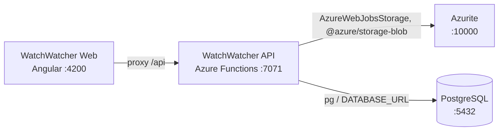

# Azure Debug Plan

> This plan is the source of truth for generating the
> VS Code debug setup in this workspace.
>
> **Status:** Implemented
> **Execution Mode:** Guided
> **Created:** 2026-11-22
> **Last Updated:** 2026-11-22
>
> <!-- Guided Mode (default) - hand-holds the user through review and approval before generating. -->

---

## Prerequisites

| Tool / Extension | Category | Service(s) | Installed | Version |
|------------------|----------|------------|-----------|---------|
| Node.js | Runtime | watchwatcher-api, watchwatcher-web | ✅ | v26.13.1 |
| npm | Package manager | watchwatcher-api, watchwatcher-web | ✅ | 11.20.0 |
| Azure Functions Core Tools | Runtime | watchwatcher-api | ✅ | 4.17.0 |
| Docker | Container runtime | watchwatcher-api | ✅ | CLI 29.1.4-rd; Docker Desktop server 29.9.3 |
| Docker Compose | Compose provider | watchwatcher-api | ✅ | v5.0.1 |
| Chrome | Browser | watchwatcher-web | ✅ | 157.0.8103.80 |
| `ms-azuretools.vscode-azurefunctions` | VS Code extension | watchwatcher-api | ✅ | 1.23.0 |

> ✅ All listed prerequisites were rechecked on 2026-11-22. Docker engine reachability and the Azure Functions VS Code extension are confirmed.

---

## Debug Configurations

The Angular service already has browser launch configurations and npm tasks under `services/watchwatcher-web/.vscode/`. Preserve those files. The workspace root has no `launch.json` or `tasks.json`; generate the root-level service and compound configurations without replacing the existing service-local files. The existing root `docker-compose.yml` already defines PostgreSQL and Azurite and must be preserved.

| Generate | Debug Config Name | Service Label | Service Root | Project Type | Runtime | Version | Azure Dependencies |
|----------|--------------------|---------------|--------------|--------------|---------|---------|---------------------|
| [x] | WatchWatcher API (debug) | watchwatcher-api | ./services/watchwatcher-api | functions | node-ts | 26.13.1 | Azure Storage, PostgreSQL |
| [x] | WatchWatcher Web (debug) | watchwatcher-web | ./services/watchwatcher-web | frontend-spa | node-ts | 26.13.1 | — |
| [x] | Debug All Services | Debug All Services | . | *Compound Config* | — | — | — |

ℹ️ Project Type Descriptions

| Project Type | Description |
|-------------|-------------|
| functions | Azure Functions serverless API with HTTP triggers |
| frontend-spa | Angular single-page application served by a development server |
| *Compound Config* | Starts the API before the dependent web frontend and browser debugger |

> ℹ️ **Proxy detected:** `services/watchwatcher-web/proxy.conf.json` forwards `/api` to `http://127.0.0.1:7071`. Start the API before the web frontend in the compound configuration.

---

## Orchestrator

| Orchestrator | Container Runtime | Compose Command | Description |
|-------------|-------------------|-----------------|-------------|
| Docker Compose | Docker | `docker compose` | Uses the existing Compose definition for PostgreSQL and Azurite. Docker CLI and Compose are present, but the Docker engine was unreachable during this scan. |

---

## Emulators

| Dependent Service | Emulator | Purpose |
|-------------------|----------|---------|
| Azure Storage | Azurite Container | Local Functions host storage and blob-storage dependency via `AzureWebJobsStorage` and `AZURITE_CONNECTION_STRING`. |
| PostgreSQL | PostgreSQL Container | Local account and progress persistence via `DATABASE_URL`. |

> **PostgreSQL host port:** `5433` (remapped from `5432`, which was occupied by a host PostgreSQL process when generation began).

---

## Architecture Diagram

The Angular app calls the local Functions API through its `/api` proxy; the API uses Azurite for local storage and PostgreSQL for account-scoped data.

---

## Migrations

When selected, the existing migration command applies the API schema to the local PostgreSQL emulator before the API starts.

| Generate | Service | Migration Tool |
|----------|---------|---------------|
| [x] | watchwatcher-api | node-pg-migrate (`services/watchwatcher-api/migrations/`; existing `migrate` script) |

---

## API Test Collections

| Generate | Service | Description |
|----------|---------|-------------|
| [x] | watchwatcher-api | 

HTTP Endpoints (9)
 GET /api/health POST /api/auth/register POST /api/auth/login POST /api/auth/session GET /api/auth/me GET /api/progress PUT /api/progress POST /api/exam/evaluate GET /api/openapi.json
 |

Generated scripts: `api-test-collections/watchwatcher-api/`

> 🔒 = requires authentication (set `WATCHWATCHER_TOKEN` to a JWT returned by register or login before running protected scripts).

### GET /api/health `http-health`

### POST /api/auth/register `http-register`

### POST /api/auth/login `http-login`

### POST /api/auth/session `http-session`

### GET /api/auth/me 🔒 `http-getMe`

### GET /api/progress 🔒 `http-getProgress`

### PUT /api/progress 🔒 `http-syncProgress`

### POST /api/exam/evaluate 🔒 `http-evaluateAnswer`

### GET /api/openapi.json 🔒 `http-openapi`

---

## Convenience Scripts

| Generate | Script | Registered In | Description |
|----------|--------|---------------|-------------|
| [x] | emulators:start | ./package.json | Start the existing PostgreSQL and Azurite Compose services in the background. |
| [x] | emulators:stop | ./package.json | Stop the existing emulator containers without deleting their data volumes. |
| [x] | migrate | ./services/watchwatcher-api/package.json | Use the existing node-pg-migrate command to apply pending API migrations. |

## Debug Configuration Checklist

✅ WatchWatcher API (debug) — Functions host reached ready, Node inspector listened on 9229, and GET /api/health returned HTTP 200 (degraded only because optional Gemini is unset; database and blob storage were healthy).

✅ WatchWatcher Web (debug) — Angular watch server reached bundle generation complete and GET / returned HTTP 200 on port 4200.

✅ Debug All Services — API then web each started once; both returned HTTP 200 and the Angular /api/health proxy returned HTTP 200.

> Native VS Code task-provider execution and browser debugger attachment remain unverified because the task runner did not resolve the newly generated task label; equivalent task commands were executed manually in the configured sequence.

> ✅ Final teardown — API, web, watcher, and emulator processes stopped; generated ports 4200, 5433, 7071, 9229, 10000, 10001, and 10002 released; named data volumes preserved. Existing host PostgreSQL PID 13160 remains on port 5432 and was not modified.